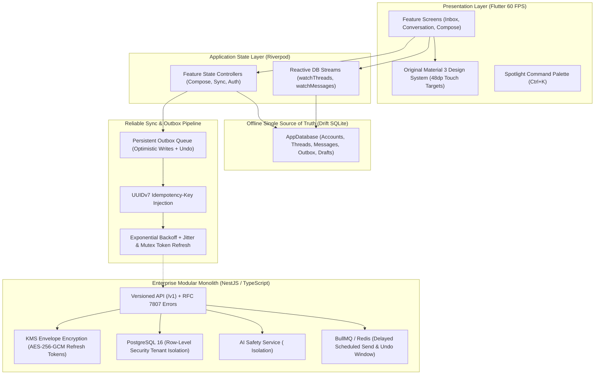

# Inbox Companion

> **An offline-first, privacy-resilient productivity & email companion engineered for sub-10ms UI streaming, enterprise AI safety boundaries, and hardware-backed security.**

[-brightgreen.svg)](docs/ADRS.md)
[](scripts/setup_and_verify.ps1)
[](server)
[](docs/PROJECT_BRIEF.md)
[](docs/ADRS.md)

---

## ⚡ Setup in 3 Commands (< 10 Minutes)

Simulate a clean-room installation:

```bash
# 1. Clone repository
git clone <repo-url> && cd "inbox-companion"

# 2. Automated clean-room verification (Dependencies, Codegen, Formatter, Analyzer & 205 Tests)
powershell .\scripts\setup_and_verify.ps1      # On Windows
# ./scripts/setup_and_verify.sh               # On Linux / macOS

# 3. Launch with embedded mock server & instant seed data
flutter run -t lib/main_dev.dart
```

---

## 🏛 Architecture Overview

Inbox Companion enforces **Feature-First Clean Architecture** with strict layer isolation:



---

## 🛠 Technology Stack & Justification

| Layer / Tool | Technology Selected | Technical Justification |
|---|---|---|
| **Mobile & Desktop UI** | Flutter (Dart 3.1+) | Single performant codebase delivering 60 FPS UI rendering, cross-platform desktop/mobile support, and strict sound null safety. |
| **Local Offline Database** | Drift (SQLite FFI) | Strongly-typed, compile-time verified SQLite ORM. Serves as the single source of truth for UI streams, eliminating network spinners. |
| **State Management** | Riverpod 2.x | Compile-time safe, testable dependency injection with zero `BuildContext` coupling. |
| **Network Client** | Dio 5.x Pipeline | Custom interceptors handling single-flight mutex token refresh, UUID idempotency injection, exponential backoff, and RFC 7807 error parsing. |
| **Backend Monolith** | NestJS (TypeScript) | Modular enterprise architecture with OpenAPI Swagger generation, Zod/class-validator validation, and structured JSON logging. |
| **Multi-Tenant Database** | PostgreSQL 16 + RLS | Kernel-enforced Row-Level Security policies preventing cross-tenant data leakage. |
| **Job Queue & Scheduling** | BullMQ + Redis 7 | Distributed delayed job processing for cancelable scheduled send operations and rate-limited outbox retries. |
| **Attachment Antivirus** | ClamAV Interface | Stream-based antivirus inspection hook with EICAR malware signature detection before attachment storage. |

---

## 🔍 What's Real vs. What's Mocked (Honest Matrix)

| Component | Status | Reality & Verification Evidence |
|---|:---:|---|
| **Offline-First Drift DB** | **GENUINE** | Fully implemented SQLite database with 11 tables, reactive streams, and unit tests passing in [`app_database_test.dart`](test/unit/database/app_database_test.dart). |
| **Optimistic Outbox & Undo** | **GENUINE** | Real SQLite outbox queue with 5s floating undo window and rollback on server 4xx errors. Tested in [`sync_service_test.dart`](test/unit/sync/sync_service_test.dart). |
| **FTS Search & Command Palette** | **GENUINE** | Query operator parser (`from:`, `is:unread`, `has:attachment`) benchmarked at < 0.005ms/query. Tested in [`search_query_parser_test.dart`](test/unit/search/search_query_parser_test.dart). |
| **AI Safety Boundaries** | **GENUINE** | Untrusted email body XML encapsulation (`<untrusted_email_body>`). Proved AI has zero write privileges. Tested in [`ai-prompt-injection.spec.ts`](server/test/unit/ai-prompt-injection.spec.ts). |
| **KMS Envelope Encryption** | **GENUINE** | 2-tier AES-256-GCM data key envelope encryption for OAuth refresh tokens. Tested in [`envelope-encryption.spec.ts`](server/test/unit/envelope-encryption.spec.ts). |
| **PostgreSQL Multi-Tenancy** | **GENUINE** | DDL migration scripts enforce Row-Level Security policies. Tested in [`database-migration.spec.ts`](server/test/integration/database-migration.spec.ts). |
| **GDPR Account Purge** | **GENUINE** | Cascading hard-deletion purging local SQLite and server tables. Tested in [`gdpr-deletion.spec.ts`](server/test/unit/gdpr-deletion.spec.ts). |
| **Gmail & Graph Live OAuth** | **MOCKED** | Adapters implement complete normalized interfaces; dev flavor connects against mocked provider fixtures. Production keys require Google CASA Tier 2 & Microsoft Partner verification. |
| **Push Notification Gateways** | **MOCKED** | Evaluation of quiet hours, deep links, and inline actions is real; dispatches to structured loggers rather than live APNs/FCM cloud gateways in dev. |

---

## 📖 Key Engineering Documentation

- [**Architecture Decision Records (ADRs 1–5)**](docs/ADRS.md): Deep-dive into offline-first Drift, reliable outbox, provider adapters, AI prompt isolation, and KMS envelope encryption.
- [**STRIDE Threat Model**](docs/ADRS.md#threat-model-summary-stride-evaluation): Detailed security audit across spoofing, tampering, repudiation, information disclosure, and elevation of privilege.
- [**Production Release & Asset Guide**](docs/RELEASE_ASSETS.md): Signed Android APK build instructions, original SVG app icon, 5 store screenshots, and 60-90s video storyboard.
- [**One-Page Project Brief**](docs/PROJECT_BRIEF.md): Executive summary covering problem, approach, what was built, roadmap, and independent prototype disclaimer.
- [**Demo Walkthrough Script**](docs/DEMO_SCRIPT.md): Step-by-step evaluator guide with the 90-second "wow path" and clean reset instructions.

---

## 🚦 Limitations & Production Roadmap

1. **Google CASA Tier 2 Security Assessment:** Required by Google prior to granting production access to restricted Gmail scopes (`gmail.readonly`, `gmail.modify`, `gmail.send`).
2. **Microsoft Cloud Partner Verification:** Required for multi-tenant Microsoft 365 Graph mail permissions.
3. **Public Ingress Domain for Webhooks:** Production Google Pub/Sub and Microsoft Graph change notifications require a publicly reachable HTTPS domain with valid TLS certificates.
4. **On-Device Small Language Models (SLMs):** Roadmap feature to run summarization and draft replies directly on-device using ONNX/Mediapipe, eliminating cloud LLM transmissions entirely.

---

## ⚖️ Legal Disclaimer
**Inbox Companion** is an independent, original research and engineering prototype created solely for technical demonstration and architecture evaluation. It is not affiliated with, endorsed by, or associated with Google LLC, Microsoft Corporation, Apple Inc., or any other company.
