# Inbox Companion - Database Entity-Relationship Diagram (ERD)

This document diagrams the complete PostgreSQL relational schema supporting UUIDv7 primary keys, Row-Level Security (RLS) isolation per `user_id`, timestamptz auditability, and partial index optimization for high-throughput mobile inbox triage.

```mermaid
erDiagram
    USERS ||--o{ DEVICES : owns
    USERS ||--o{ SESSIONS : has
    USERS ||--o{ CONNECTED_ACCOUNTS : links
    USERS ||--o{ THREADS : triages
    USERS ||--o{ LABELS : creates
    USERS ||--o{ DRAFTS : authors
    USERS ||--o{ OUTBOX_OPERATIONS : enqueues
    USERS ||--o{ SCHEDULED_MESSAGES : plans
    USERS ||--o{ REMINDERS : sets
    USERS ||--o{ TASKS : assigns
    USERS ||--o{ CALENDAR_EVENTS : schedules
    USERS ||--o{ NOTIFICATION_TOKENS : registers
    USERS ||--o{ AI_REQUESTS : queries
    USERS ||--o{ AUDIT_LOG : tracks

    CONNECTED_ACCOUNTS ||--|| OAUTH_CREDENTIALS : holds_encrypted
    CONNECTED_ACCOUNTS ||--o{ THREADS : contains
    CONNECTED_ACCOUNTS ||--o{ MESSAGES : delivers
    CONNECTED_ACCOUNTS ||--o{ LABELS : organizes
    CONNECTED_ACCOUNTS ||--o{ DRAFTS : originates
    CONNECTED_ACCOUNTS ||--o{ SYNC_CURSORS : maintains

    THREADS ||--o{ MESSAGES : contains
    THREADS ||--o{ THREAD_LABELS : tagged_by
    LABELS ||--o{ THREAD_LABELS : applies_to
    THREADS ||--o{ REMINDERS : alerts_on
    THREADS ||--o{ TASKS : generates

    MESSAGES ||--|| MESSAGE_BODIES : stores_content
    MESSAGES ||--o{ ATTACHMENTS : includes

    DEVICES ||--o{ SESSIONS : binds_to
    DEVICES ||--o{ NOTIFICATION_TOKENS : associates

    DRAFTS ||--o{ SCHEDULED_MESSAGES : targets

    USERS {
        uuid id PK
        varchar email UK
        varchar display_name
        text avatar_url
        timestamptz created_at
        timestamptz updated_at
        timestamptz deleted_at
    }

    DEVICES {
        uuid id PK
        uuid user_id FK
        varchar device_name
        varchar platform
        varchar app_version
        text push_token
        timestamptz last_active_at
        timestamptz created_at
    }

    SESSIONS {
        uuid id PK
        uuid user_id FK
        uuid device_id FK
        uuid refresh_token_family
        varchar current_token_hash
        boolean is_revoked
        timestamptz expires_at
        varchar ip_address
        text user_agent
        timestamptz created_at
        timestamptz updated_at
    }

    CONNECTED_ACCOUNTS {
        uuid id PK
        uuid user_id FK
        varchar provider
        varchar external_id
        varchar email
        varchar display_name
        jsonb scopes
        varchar status
        timestamptz created_at
        timestamptz updated_at
    }

    OAUTH_CREDENTIALS {
        uuid id PK
        uuid connected_account_id FK,UK
        uuid user_id FK
        text encrypted_access_token
        text encrypted_refresh_token
        varchar iv
        varchar tag
        varchar token_type
        timestamptz expires_at
        timestamptz created_at
        timestamptz updated_at
    }

    THREADS {
        uuid id PK
        uuid user_id FK
        uuid account_id FK
        varchar external_thread_id
        text subject
        text snippet
        boolean is_unread
        boolean is_starred
        varchar folder
        boolean has_attachments
        integer message_count
        timestamptz last_message_at
        timestamptz created_at
        timestamptz updated_at
        timestamptz deleted_at
    }

    MESSAGES {
        uuid id PK
        uuid user_id FK
        uuid thread_id FK
        uuid account_id FK
        varchar external_message_id
        varchar sender_name
        varchar sender_email
        jsonb to_recipients
        jsonb cc_recipients
        jsonb bcc_recipients
        boolean is_unread
        timestamptz sent_at
        timestamptz created_at
    }

    MESSAGE_BODIES {
        uuid id PK
        uuid message_id FK,UK
        uuid user_id FK
        text body_plain
        text body_html
        text snippet
        timestamptz created_at
    }

    ATTACHMENTS {
        uuid id PK
        uuid message_id FK
        uuid user_id FK
        varchar filename
        varchar content_type
        bigint size_bytes
        text storage_path
        timestamptz created_at
    }

    LABELS {
        uuid id PK
        uuid user_id FK
        uuid account_id FK
        varchar name
        varchar color_hex
        timestamptz created_at
        timestamptz updated_at
    }

    THREAD_LABELS {
        uuid thread_id PK,FK
        uuid label_id PK,FK
        uuid user_id FK
    }

    DRAFTS {
        uuid id PK
        uuid user_id FK
        uuid account_id FK
        uuid reply_thread_id FK
        uuid reply_message_id FK
        jsonb to_recipients
        jsonb cc_recipients
        jsonb bcc_recipients
        text subject
        text body_plain
        text body_html
        jsonb attachments_meta
        timestamptz created_at
        timestamptz updated_at
    }

    OUTBOX_OPERATIONS {
        uuid id PK
        uuid user_id FK
        uuid account_id FK
        varchar idempotency_key UK
        varchar action_type
        varchar target_id
        jsonb payload
        varchar status
        integer retry_count
        text error_message
        timestamptz created_at
        timestamptz updated_at
    }

    SCHEDULED_MESSAGES {
        uuid id PK
        uuid user_id FK
        uuid account_id FK
        uuid draft_id FK
        timestamptz scheduled_at
        varchar timezone
        varchar status
        timestamptz created_at
        timestamptz updated_at
    }

    REMINDERS {
        uuid id PK
        uuid user_id FK
        uuid thread_id FK
        varchar title
        timestamptz due_at
        boolean is_dismissed
        timestamptz created_at
        timestamptz updated_at
    }

    TASKS {
        uuid id PK
        uuid user_id FK
        uuid thread_id FK
        varchar title
        timestamptz due_date
        boolean is_completed
        timestamptz created_at
        timestamptz updated_at
    }

    CALENDAR_EVENTS {
        uuid id PK
        uuid user_id FK
        uuid account_id FK
        varchar title
        text description
        text location
        text join_url
        timestamptz start_time
        timestamptz end_time
        boolean is_all_day
        jsonb attendees
        timestamptz created_at
        timestamptz updated_at
    }

    SYNC_CURSORS {
        uuid id PK
        uuid user_id FK
        uuid account_id FK
        varchar sync_key
        text cursor_value
        varchar status
        timestamptz last_synced_at
        timestamptz created_at
        timestamptz updated_at
    }

    NOTIFICATION_TOKENS {
        uuid id PK
        uuid user_id FK
        uuid device_id FK
        text token
        varchar platform
        timestamptz created_at
        timestamptz updated_at
    }

    AI_REQUESTS {
        uuid id PK
        uuid user_id FK
        varchar request_type
        varchar tone
        integer prompt_tokens
        integer completion_tokens
        varchar status
        timestamptz created_at
    }

    AUDIT_LOG {
        uuid id PK
        uuid user_id FK
        varchar action
        varchar resource_type
        varchar resource_id
        varchar ip_address
        jsonb metadata
        timestamptz created_at
    }
```



---

## Row-Level Security (RLS) Multi-Tenant Invariant

All operational queries enforce the active session identity:
```sql
SET LOCAL app.current_user_id = '<authenticated_user_uuid>';
```
Under PostgreSQL's RLS engine, any attempt to read, insert, update, or delete rows where `user_id != app.current_user_id` yields empty result sets or permission denial, preventing cross-tenant data leaks even in the event of an application logic bug.
